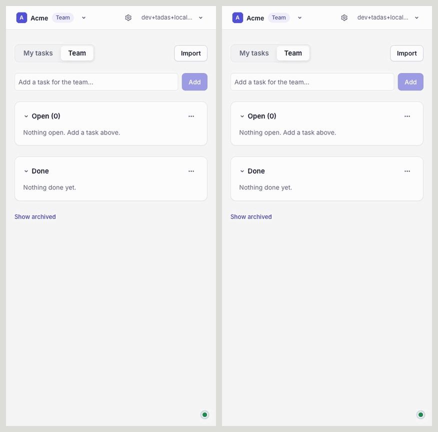
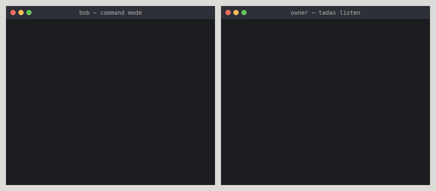

# Tadas

Tadas is a multi-tenant to-do application for teams of people and the
agents that work alongside them. A team keeps one list in the order it
chose, and every change reaches every open screen and terminal as it
happens.

Tadas is also the reference implementation of the Software Design and
Architecture Guidelines ([the pin](specs/architecture.md)): one object
model at the center, one infrastructure toolkit, an API process and a
maintenance worker around them, and a portal, a command line, and the
clients at the edge.

Its base is the guideline's scaffold,
[`scaffold/acme_root/`](https://github.com/baristaze/swe_guidelines/tree/v0.64.0/scaffold/acme_root)
at v0.64.0, rendered as Tadas. The `scaffold` branch keeps each render,
and the main branch merges it, so every difference from the scaffold is
Tadas's own. `/swe-guidelines:arch-upgrade-scaffold` moves the base to
a later release by a merge.

<p align="center">
  
</p>

Two of the seeded people on their team's list: each change Bob makes
reaches the owner's window as it happens. `make demo-gif` records it.

<p align="center">
  
</p>

The same from two terminals, with the owner's `tadas listen` on the
right. `make demo-cli-gif` records it.

## What a team does

A task has a title, notes, a due date with one reminder, an assignee,
and attachments. A team imports its list from a CSV file, and a done
task nobody touched for ninety days is archived, never deleted. People
sign in through WorkOS, by an email code, Google, Microsoft, Apple,
GitHub, or their company's single sign-on, and never with a password.
Each has a personal org, and joins a team org by invitation or through
that single sign-on. An org pays
for its plan through Stripe. A team can bring Tadas into its Slack
channel, where it posts and answers `/tadas`.
[What Tadas is made of](om/README.md) tells it for a reader with no
code.

## Quick start

Requirements: uv, Node (see `.nvmrc`), and Docker. `make setup`
installs pnpm, at the version `package.json` names, when it is missing.

```bash
make up       # the whole stack in containers, migrated and seeded; prints the URLs
make stop     # pause it: the ports free up, the containers and the data stay
make start    # resume it, with no build, migration, or seed; `make up` on a new tree
make down     # remove the containers; the data stays
make reset    # wipe the data and the containers, then `make up`
make urls     # print the URLs and the sign-ins again
```

`make up` ends by printing every local URL and the seeded people, and
`make urls` prints them again. Each seeded person is a plus-address of
your `SEED_EMAIL` (set it in `.env`; git's `user.email` otherwise), and
signs in at `/login` through WorkOS's Staging application, as anyone
does, once `TADAS_WORKOS_API_KEY` holds its `tadas-local` key
([the WorkOS runbook](docs/runbooks/providers/workos.md#local-development)). [The local stack](deployment/local/README.md#ports)
has every port, each a knob in `.env.example`: set it in `.env` when a
port is taken.

## Set up and check

```bash
make setup             # Python and TypeScript dependencies
make infra-up          # Postgres (one per database role), Valkey, ElasticMQ, and MinIO alone
make migrate           # the database logins, then every role's migration chain
make seed              # the two orgs, their people, and the local operators
make check             # lint, format, types, arch-check, unit tests
make migrate-check     # every role's ORM metadata against the migrated schema
make test-integration  # the storage contracts over Postgres
```

`make help` lists every target and what it does.

`scripts/dev.sh` runs the processes on the host with hot reload. A
variable exported in the shell wins over `.env`, so a second checkout
points all eight database URLs at a database of its own: the four
shared `TADAS_DATABASE_*` URLs and the four `TADAS_DATABASE_URL_<ROLE>`,
since a role's own URL wins.
[deployment/local/README.md](deployment/local/README.md) works on one
service at a time.

## Deploy and operate

`main` is staging and `release` is production. A merge to `main`
deploys staging. A person fast-forwards `release` and approves the
production plan. [The deploy runbook](docs/runbooks/deploy.md) has the
steps and the rollback. A deployed environment has no seed: a person
signs in through WorkOS, and a first sign-in is the sign-up.

Each operational task is a skill a person runs with an agent, and the
credential the skill holds is its boundary. [ops/README.md](ops/README.md)
names the roles, the skills, and the audits.
[The runbooks](docs/runbooks/README.md) hold the procedures a person
follows by hand.

## Layout

- `libs/`: the leaf distributions any other may import.
  [timing/](libs/timing/README.md) is the wait between attempts every
  loop and client shares.
- [om/](om/README.md): the object model: namespaces, storage, migrations.
- [infra/](infra/README.md): the capabilities the system asks for and
  never implements itself, each with its twin.
- [integrations/](integrations/README.md): Slack, WorkOS, and Stripe, each an interface, a client, and a twin, and the webhook check.
- `services/`, `workers/`, and `apps/`: one folder per service, worker,
  and client app, each with its README. The API is
  [services/api/](services/api/README.md), the work queue's worker
  [workers/maintenance/](workers/maintenance/README.md), and the shell
  every screen sits in [apps/portal/](apps/portal/README.md).
- `clients/`: [openapi/](clients/openapi/), each namespace's committed API
  document; [typescript/](clients/typescript/README.md), the one client every
  browser app imports; and [python/](clients/python/README.md), the one Python
  client.
- [deployment/](deployment/README.md): compose, images, and Terraform.
- [ops/](ops/README.md): the operators' package, skills, and stress scenarios.
- `docs/`: [adr/](docs/adr/README.md), the decisions, and
  [runbooks/](docs/runbooks/README.md);
  [specs/architecture.md](specs/architecture.md) pins the guideline and
  lists the deviations.
- [llms.txt](llms.txt): the knowledge map, each document by the reader
  it serves.
