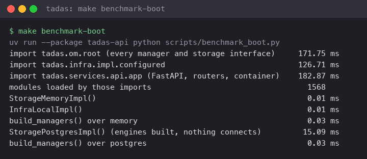

# ADR 1004: The roots' boot cost is measured with Tadas's product

**Status**: accepted (2026-10-14)

## Context

[ADR 0007, Roots are built whole at boot, once per process](0007-roots-built-whole-at-boot.md)
measures what a root costs with `make benchmark-boot`, and makes its
table the reference the re-test compares with. Tadas's roots also
build its product: the tasks, billing, and Slack managers, their
storage, and the integrations they call. Each adds imports to every
process.

## Decision

The re-test in Tadas compares with Tadas's own measurement, taken with
`make benchmark-boot` (warm, Apple silicon) on 2026-09-18:

| Step | Cost |
|------|------|
| import `tadas.om.root` (every manager and storage interface) | 171.75 ms |
| import `tadas.infra.impl.configured` | 126.71 ms |
| import `tadas.services.api.app` (FastAPI, routers, container) | 182.87 ms |
| modules loaded by those imports | 1,568 |
| `StorageMemoryImpl()`, `InfraLocalImpl()` | 0.01 ms |
| `build_managers()` over either storage root | 0.03 ms |
| `StoragePostgresImpl()` (engines built, nothing connects) | 15.09 ms |

## Consequences

The product moves the import rows, not the construction: building
every manager still takes microseconds. A new namespace of Tadas's is
measured again, and this table follows it.
